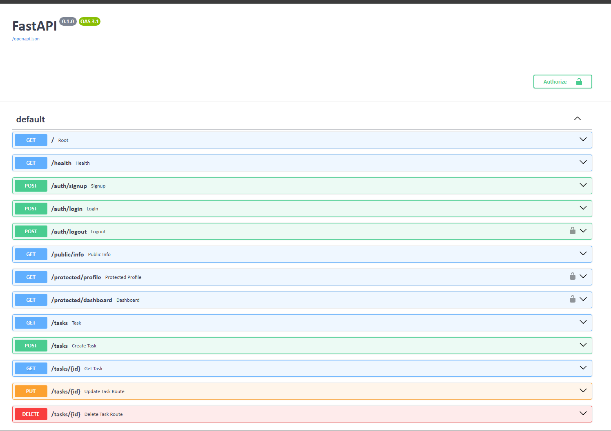

<div align="center">

# Task API

A RESTful Task Management API built with **FastAPI, PostgreSQL, Docker Compose, and Supabase Authentication**.

<p>
  
  
  
  
  
</p>

</div>

---

# About

This project was built as part of a **Backend Engineering Internship**.

It is a RESTful Task Management API built with FastAPI and PostgreSQL. The project demonstrates CRUD operations, database integration, user authentication, JWT-based protected routes, and interactive API documentation using Swagger UI.

The application uses **Supabase Auth** for user signup, login, logout, and JWT verification.

The complete application can be started using Docker Compose.

---

# Features

- Create, read, update, and delete tasks
- PostgreSQL database integration
- Docker Compose setup
- Automatic database table creation
- Automatic sample task seeding
- Search tasks by title
- Filter tasks by completion status
- Request validation using Pydantic
- Parameterized SQL queries
- Proper HTTP status handling
- User signup
- User login
- User logout
- JWT-based authentication
- Protected API routes
- Token verification using Supabase Auth
- Public and protected endpoints
- Interactive Swagger UI
- Bearer token authorization in Swagger UI

---

# Tech Stack

- **Python 3.13**
- **FastAPI**
- **Pydantic**
- **PostgreSQL**
- **Psycopg**
- **Supabase Auth**
- **Docker**
- **Docker Compose**
- **Swagger UI**

---

# Project Structure

```text
.
├── auth.py
├── database.py
├── main.py
├── schemas.py
├── supabase_client.py
├── Dockerfile
├── compose.yaml
├── requirements.txt
├── .env.example
├── .gitignore
├── README.md
└── screenshots/
```

| File | Description |
|------|-------------|
| `main.py` | FastAPI application and API routes |
| `auth.py` | JWT authentication and current-user verification |
| `database.py` | PostgreSQL connection and database queries |
| `schemas.py` | Pydantic request models |
| `supabase_client.py` | Supabase client configuration |
| `Dockerfile` | Docker image configuration |
| `compose.yaml` | Docker Compose services |
| `requirements.txt` | Python dependencies |
| `.env.example` | Example environment variables |
| `screenshots/` | Project screenshots |
| `README.md` | Project documentation |

---

# Prerequisites

Make sure the following are installed:

- Docker Desktop
- Git
- A Supabase account

---

# Supabase Setup

This project uses Supabase Authentication.

## 1. Create a Supabase project

Create a project from the Supabase dashboard.

## 2. Get the project credentials

From the Supabase project settings, obtain:

- Project URL
- Publishable key

These values are required by the application.

---

# Environment Variables

Create a `.env` file in the project root.

Use `.env.example` as a template:

```env
DATABASE_URL=postgres://postgres:dev@db:5432/tasks

SUPABASE_URL=your_project_url
SUPABASE_KEY=your_supabase_publishable_key
```

Replace the Supabase placeholder values with your own project credentials.

The `.env` file is listed in `.gitignore` and **must never be committed to GitHub**.

Do not share your Supabase credentials publicly.

---

# Getting Started

## 1. Clone the repository

```bash
git clone <your-repository-url>
cd Assignment-1-Task-API
```

## 2. Create the environment file

On Windows PowerShell:

```powershell
Copy-Item .env.example .env
```

On macOS/Linux:

```bash
cp .env.example .env
```

Then edit `.env` and add your own Supabase credentials.

## 3. Start the application

Run:

```bash
docker compose up --build
```

This starts:

- FastAPI on port `8000`
- PostgreSQL on the Docker network
- Persistent PostgreSQL storage using a Docker volume

The API will be available at:

```text
http://localhost:8000
```

---

# API Documentation

FastAPI automatically provides interactive API documentation.

### Swagger UI

```text
http://localhost:8000/docs
```

### ReDoc

```text
http://localhost:8000/redoc
```

Swagger UI can be used to test the API, including authenticated protected endpoints.

---

# Authentication

The API uses **Supabase Auth** for authentication.

## Signup

Create a new account using:

```text
POST /auth/signup
```

Example request:

```json
{
  "email": "user@example.com",
  "password": "your_password"
}
```

---

## Login

Login using:

```text
POST /auth/login
```

Example request:

```json
{
  "email": "user@example.com",
  "password": "your_password"
}
```

A successful login returns an access token:

```json
{
  "access_token": "your_access_token",
  "refresh_token": "your_refresh_token"
}
```

The `access_token` is used to access protected endpoints.

---

## Using the JWT

Protected endpoints require the access token in the HTTP Authorization header:

```text
Authorization: Bearer <access_token>
```

In Swagger UI:

1. Open `/docs`
2. Click **Authorize**
3. Enter the access token
4. Click **Authorize**
5. Use the protected endpoints

---

# API Reference

| Method | Endpoint | Description | Authentication |
|--------|----------|-------------|----------------|
| POST | `/auth/signup` | Create a new user account | No |
| POST | `/auth/login` | Login and receive access token | No |
| POST | `/auth/logout` | Logout the authenticated user | Yes |
| GET | `/public/info` | Public information | No |
| GET | `/protected/profile` | Get authenticated user profile | Yes |
| GET | `/protected/dashboard` | Access protected dashboard | Yes |
| GET | `/` | API information | No |
| GET | `/health` | Health check | No |
| GET | `/tasks` | Get all tasks | No |
| GET | `/tasks/{id}` | Get a task by ID | No |
| POST | `/tasks` | Create a task | No |
| PUT | `/tasks/{id}` | Update a task | No |
| DELETE | `/tasks/{id}` | Delete a task | No |

---

# Task Search and Filtering

The `/tasks` endpoint supports optional query parameters.

## Search by title

```text
GET /tasks?search=FastAPI
```

## Filter by completion status

```text
GET /tasks?completed=true
```

or:

```text
GET /tasks?completed=false
```

---

# Example Requests

## Create a Task

```http
POST /tasks
```

Request body:

```json
{
  "title": "Learn Docker"
}
```

---

## Update a Task

```http
PUT /tasks/1
```

Request body:

```json
{
  "title": "Learn Docker Compose",
  "completed": true
}
```

---

## Get All Tasks

```http
GET /tasks
```

Example response:

```json
[
  {
    "id": 1,
    "title": "Learn FastAPI",
    "completed": false
  },
  {
    "id": 2,
    "title": "Build CRUD API",
    "completed": false
  },
  {
    "id": 3,
    "title": "Write README",
    "completed": true
  }
]
```

---

# Database

The application uses **PostgreSQL** running inside Docker.

On startup, the application:

- Connects to PostgreSQL
- Creates the `tasks` table if it does not exist
- Inserts sample tasks if the table is empty

## Table Schema

| Column | Type |
|--------|------|
| `id` | SERIAL PRIMARY KEY |
| `title` | TEXT NOT NULL |
| `completed` | BOOLEAN NOT NULL |

---

# Database Persistence

Docker Compose uses a named volume for PostgreSQL data.

This allows task data to remain available when the containers are restarted.

```text
taskdata
```

---

# Validation and Error Handling

The API includes basic validation and HTTP error handling.

Examples:

- Empty task titles return `400 Bad Request`
- Missing authentication returns `401 Unauthorized`
- Invalid or expired JWTs return `401 Unauthorized`
- Unknown task IDs return `404 Not Found`
- Successful task creation returns `201 Created`
- Successful deletion returns `204 No Content`

---

# Security

The project follows basic security practices:

- Supabase handles user authentication
- JWTs are verified before protected routes are accessed
- Protected endpoints require Bearer authentication
- SQL queries use parameterized placeholders
- `.env` is excluded from Git using `.gitignore`
- Supabase credentials are stored in environment variables
- Actual credentials are not included in the repository

---

# Swagger UI

Swagger UI provides an interactive interface for testing the API.

Protected routes display a lock icon and can be accessed after providing a valid Bearer token.



---

# Screenshots

## Swagger UI


---

# What I Learned

- Building REST APIs using FastAPI
- Request validation with Pydantic
- CRUD operations with PostgreSQL
- Parameterized SQL queries
- Connecting Python to PostgreSQL using Psycopg
- Running services with Docker and Docker Compose
- Persisting database data using Docker volumes
- User authentication with Supabase
- JWT-based authentication
- Protecting API routes
- Testing authenticated endpoints using Swagger UI
- Managing environment variables securely
- Documenting and publishing a backend project on GitHub

---
